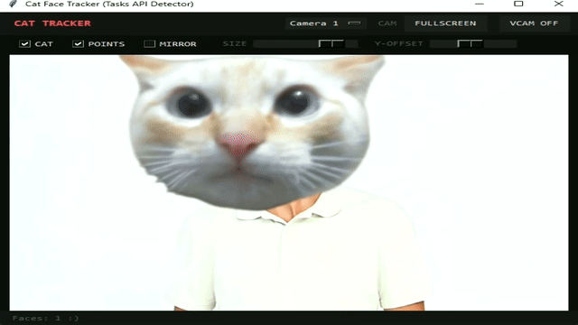

# Cat VTuber

<p align="center">
  <a href="https://microsoft.com/windows"></a>
  <a href="https://python.org"></a>
  <a href="https://developers.google.com/mediapipe"></a>
  <a href="https://obsproject.com"></a>
  <a href="LICENSE"></a>
</p>

Легковесный трекер лица и генератор виртуального аватара (VTuber) в реальном времени. Скрипт в реальном времени отслеживает положение, наклон и масштаб лица через стандартную веб-камеру с помощью нейросети MediaPipe BlazeFace и бесшовно проецирует аватара, транслируя готовый видеопоток в виртуальную камеру для Discord, Zoom, OBS, Telegram и любых других сервисов видеосвязи.

Работает с высокой частотой кадров без фризов благодаря многопоточной обработке видеопотока, не перегружает процессор и не требует дискретной видеокарты.

<p align="center">
  
</p>

## Основные возможности

* **Высокоточное отслеживание лица**: Использование модели нейросети MediaPipe FaceDetection (BlazeFace) — стабильный захват даже при наклоне головы, поворотах в профиль и слабом освещении.
* **Прямой вывод в виртуальную камеру**: Аппаратная интеграция через библиотеку `pyvirtualcam` — мгновенное подключение в Discord, Zoom, Google Meet и OBS.
* **Темная панель управления**: Стильный кастомный темный интерфейс с интерактивными ползунками для точной регулировки масштаба и вертикального смещения аватара на лету.
* **Многопоточный пайплайн захвата**: Раздельные потоки для декодирования видеокадров с веб-камеры и нейросетевого инференса устраняют любые микрофризы.
* **Поддержка мультимониторных конфигураций**: Корректное масштабирование окна и перетаскивание между экранами с разным DPI без сбоев рендера.
* **Автоматическая загрузка весов**: Скрипт самостоятельно загрузит и инициализирует необходимую модель ИИ при первом запуске.

## Быстрый старт

### Требования
* Python 3.9 или выше
* Физическая веб-камера
* [OBS Studio](https://obsproject.com/) (для создания системного драйвера виртуальной камеры)

### Установка

1. Склонируйте репозиторий:
```bash
git clone https://github.com/KreziBro/cat-vtuber.git
cd cat-vtuber
```

2. Установите необходимые Python-пакеты:
```bash
pip install opencv-python mediapipe pillow numpy pyvirtualcam
```

3. Убедитесь, что в корне каталога присутствует файл изображения аватара `cat.png` с прозрачным фоном.

### Использование

1. Запустите основной скрипт:
```bash
python cat.py
```
2. В появившемся окне нажмите переключатель **VCAM OFF**, активировав режим **VCAM ON**.
3. В настройках видео вашего приложения (Discord, Zoom, Telegram) выберите **OBS Virtual Camera** в качестве источника веб-камеры.

## Стек технологий

* **Язык**: Python 3.9+
* **Компьютерное зрение**: OpenCV, MediaPipe FaceDetection
* **Графика и математика**: Pillow, NumPy
* **Виртуальное видео**: PyVirtualCam

## Сообщество и поддержка

* Официальный Telegram канал разработчика: https://t.me/KreziBro_dev
* Поддержать развитие проекта на платформе Ko-fi: https://ko-fi.com/krejzibro

## Лицензия

Распространяется под лицензией MIT. Подробности в файле [LICENSE](LICENSE).
